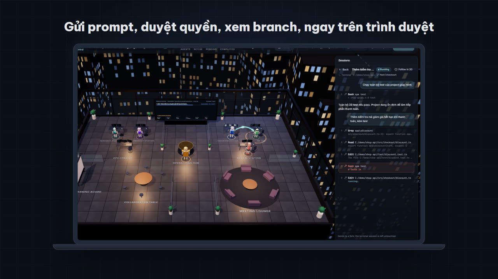
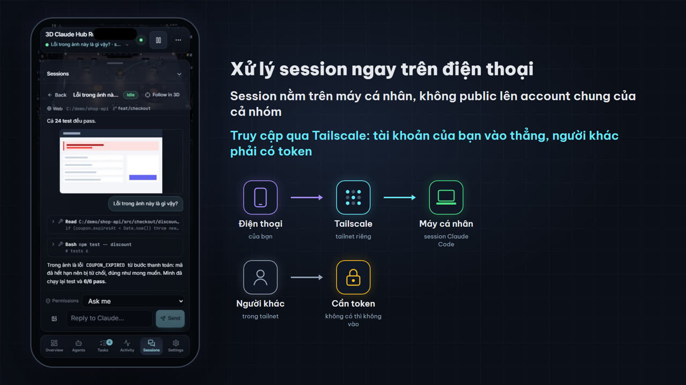

# 3D Claude Hub Remote

Một văn phòng 3D trong trình duyệt phản chiếu các session **Claude Code** đang chạy trên máy của bạn. Sáu robot đi lại, làm việc và nói chuyện đúng theo việc Claude đang làm. Bạn có thể gửi prompt, duyệt quyền và xem nhiều session song song ngay trên trình duyệt, kể cả trên điện thoại qua Tailscale. Session vẫn nằm trên máy cá nhân, không bị đẩy lên một account dùng chung.

*A 3D office in the browser that mirrors the Claude Code sessions running on your own machine. Six robots act out what Claude is doing; you can send prompts, answer permission asks and follow several sessions at once, from your phone over Tailscale. The sessions stay on your machine. The docs are in Vietnamese; the code, comments and app UI are in English.*



## Nguồn cảm hứng

Project lấy cảm hứng từ [lucwj/ai-agent-3d-prompts](https://github.com/lucwj/ai-agent-3d-prompts) của **Mr Luc**, người đã đưa không gian làm việc của AI Agent lên 3D. Repo này không chứa prompt hay hình ảnh của repo đó. Muốn tự dựng văn phòng 3D từ prompt thì hãy dùng repo gốc.

## Làm được gì

- **Văn phòng 3D phản chiếu việc thật.** Mỗi robot là một vai trò: Orion điều phối, Piper lên kế hoạch, Iris đọc và tìm, Kai viết code, Quinn chạy test, Rex xem diff. Robot chỉ di chuyển khi hook của Claude Code báo đúng loại việc đó.
- **Nhiều session song song.** Tab **Sessions** liệt kê mọi session Claude Code trên máy (chạy trong terminal, VS Code hay từ web), kèm thư mục và git branch. Từ đây bạn đọc được hội thoại, gửi prompt kèm ảnh, bấm Allow/Deny khi Claude xin quyền, và xem video Claude tạo ra trong thư mục project.
- **Dùng từ xa, riêng tư.** Mở qua Tailscale từ điện thoại hay máy khác. Tài khoản Tailscale của bạn vào thẳng, còn người khác phải có token. Giao diện có bản riêng cho điện thoại.
- **Chế độ mô phỏng.** Không cần Claude Code để xem thử: app có một kịch bản demo chạy hoàn toàn trên máy, không gọi AI nào.



## ⚠️ Đọc trước khi chạy

- **`npm run up` cho phép điều khiển Claude Code từ trình duyệt.** Ai có token, hoặc đăng nhập đúng tài khoản Tailscale của bạn, đều có thể gửi prompt và để Claude dùng công cụ (sửa file, chạy lệnh) trên máy bạn. Mặc định Claude vẫn hỏi quyền trước mỗi công cụ. Chỉ thêm `--allow-bypass` khi bạn hiểu rõ rủi ro.
  - Chỉ muốn xem mà không cho điều khiển: `npm run up -- --no-control`.
- **Mỗi prompt gửi từ web là một lượt Claude Code thật**, dùng chính tài khoản Claude của bạn, tốn phí như gõ trong terminal.
- **`npm run setup` thêm hook vào `~/.claude/settings.json`.** Script sao lưu file trước khi sửa, chỉ thêm hook của nó, và gỡ được bằng `npm run hooks:remove`. Không muốn đụng tới file này: `npm run setup -- --no-hooks`.
- **Token nằm ở `~/.aaw/token`.** Đừng chia sẻ link có `#token=…`. Không mở cổng 8787 ra internet công khai (tunnel ẩn danh, `--host 0.0.0.0`). Xem thêm [SECURITY.md](SECURITY.md).

## Cần có

- [Node.js](https://nodejs.org) 22.6 trở lên và `git`.
- [Claude Code](https://docs.claude.com/en/docs/claude-code) đã cài và đăng nhập (lệnh `claude` chạy được trong terminal). Trên Windows, Claude Code cần Git for Windows (Git Bash), và hook của project này cũng chạy qua Git Bash.
- Một trình duyệt có WebGL (Chrome, Edge, Firefox, Safari bản mới).
- Tuỳ chọn: [Tailscale](https://tailscale.com) nếu muốn mở từ điện thoại hay máy khác.

Project được dùng hằng ngày trên Windows 11. macOS và Linux có hỗ trợ (`autostart` dùng launchd và systemd). CI chạy test trên Ubuntu và Windows.

## Bắt đầu

```bash
git clone https://github.com/NinelXram/3d-claude-hub-remote.git
cd 3d-claude-hub-remote
npm run setup
npm run up
```

- `npm run setup` chạy một lần, và chạy lại sau mỗi lần `git pull`. Lệnh này:
  - kiểm tra máy;
  - cài dependency cho server và app;
  - thêm hook vào `~/.claude/settings.json`;
  - build app bản production.
- `npm run up` bật server (cổng 8787) và app (cổng 3210), tự build lại nếu code đã đổi, rồi mở trình duyệt với link có sẵn token. Ctrl+C tắt cả hai.
- Hook có hiệu lực từ **session Claude Code mới**. Mở một session mới trong terminal và gõ một prompt, robot sẽ bắt đầu chạy.

Các tuỳ chọn của `npm run up` (thêm sau `--`, ví dụ `npm run up -- --no-control`):

| Tuỳ chọn | Tác dụng |
|---|---|
| `--no-control` | Chỉ xem: không gửi prompt, không trả lời xin quyền từ web |
| `--permission-mode acceptEdits` | Chế độ quyền mặc định cho session mở từ web |
| `--allow-bypass` | Cho phép chọn chế độ bỏ qua hỏi quyền từ web (nguy hiểm) |
| `--hide-prompts` | Không hiện nội dung prompt trong thế giới 3D |
| `--record` | Ghi các hook vào `~/.aaw/sessions/<ngày>.jsonl` để phát lại. File chứa nguyên văn prompt |
| `--app-port`, `--port` | Đổi cổng app (3210) hoặc server (8787) |
| `--no-open`, `--no-build` | Không mở trình duyệt, không tự build lại |

Kiểm tra hoặc gỡ hook: `npm run hooks:status`, `npm run hooks:remove`.

## Dùng từ điện thoại hoặc máy khác

**Tailscale (khuyên dùng):**

```bash
npm run up:tailscale
```

- Lệnh này chạy `tailscale serve` và mở app cho các thiết bị **trong tailnet của bạn** tại `http://<tên-máy>.<tailnet>.ts.net/`.
- Đăng nhập Tailscale bằng chính tài khoản của bạn thì không cần token. Tài khoản khác trong tailnet, thiết bị gắn tag, và mọi tunnel khác vẫn cần token.
- Muốn có `https` (cần cho thông báo desktop trên thiết bị khác): bật **HTTPS Certificates** trong trang quản trị Tailscale, mục DNS.

**Tunnel khác:** forward cổng 8787 ở chế độ riêng tư (ví dụ Microsoft Dev Tunnels không bật truy cập ẩn danh), rồi mở link kèm `#token=…`. Token lấy trong `~/.aaw/token`.

Mỗi máy chỉ thấy các session Claude Code của chính nó.

## Tự khởi chạy khi mở máy

```bash
npm run autostart
```

- Bật `npm run up` mỗi khi bạn đăng nhập và tự khởi động lại nếu nó bị dừng. Cơ chế theo hệ điều hành:
  - macOS dùng launchd;
  - Linux dùng systemd `--user`;
  - Windows dùng một file ẩn trong thư mục Startup, không cần quyền admin.
- Nếu máy đã đăng nhập Tailscale thì tự mở cho tailnet. Chọn rõ bằng `npm run autostart -- --tunnel tailscale|devtunnel|none`.
- Quản lý bằng `npm run autostart:status`, `npm run autostart:logs`, `npm run autostart:off`. Log nằm ở `~/.aaw/logs/up.log`; token không được ghi vào log.
- macOS: nếu repo nằm trong `~/Documents`, `~/Desktop` hoặc `~/Downloads`, khi hệ thống hỏi "node" có được truy cập thư mục đó không, chọn **Allow**.

## Chỉ xem thử, không cần Claude Code

```bash
cd app
npm install
npm run dev
```

Mở http://localhost:3000 và bấm **Run demo**. Đây là chế độ mô phỏng: một kịch bản cố định chạy trong trình duyệt, không gọi AI nào, và thanh trên cùng ghi rõ "Simulation mode".

## Cấu trúc repo

| Thư mục | Nội dung |
|---|---|
| [`app/`](app/) | App Next.js: văn phòng 3D (React Three Fiber), giao diện, tab Sessions, âm thanh. Xem [app/README.md](app/README.md) |
| [`examples/phase1-engine/`](examples/phase1-engine/) | World server (WebSocket), cầu nối Claude Code hooks, Sessions (chạy Claude Code qua Agent SDK), engine mô phỏng và viewer 3D gọn nhẹ |
| [`scripts/`](scripts/) | `setup`, `up`, `autostart` |
| [`eval/phase1/`](eval/phase1/) | Bộ chấm từ bên ngoài cho engine mô phỏng, chạy trong CI |
| [`video/`](video/) | Video giới thiệu 1:30, dựng hoàn toàn bằng code từ app thật. Xem [video/README.md](video/README.md) |

## Phát triển

```bash
cd examples/phase1-engine
npm run typecheck
npm test
npm run test:ws
npm run test:live
npm run test:sessions
npm run test:session-files
npm run test:security
npm run test:install
```

```bash
cd app
npm run typecheck
npm run lint
npm test
npm run e2e
```

- `npm run e2e` cần Google Chrome.
- Kiến trúc app, giao thức WebSocket và cách viết backend riêng: [app/README.md](app/README.md).
- Cầu nối Claude Code: [examples/phase1-engine/bridge/README.md](examples/phase1-engine/bridge/README.md).

## Giới hạn hiện tại

- Chỉ hiểu **Claude Code**. Chưa có adapter cho OpenAI Agents, LangGraph hay framework khác.
- Việc robot nào làm gì được suy ra từ tên công cụ và câu lệnh (ví dụ lệnh nào là chạy test). Đây là heuristic: test chạy qua pipe hay runner lạ có thể bị đoán sai.
- Workflow cố định 6 vai và một đường đi (lên kế hoạch → nghiên cứu → viết code → test → review). Subagent lồng nhau hay số agent thay đổi chưa được thể hiện riêng.
- Thế giới 3D chưa có mô tả cho screen reader. Chỉ phần giao diện HTML dùng được bằng bàn phím.
- Giao diện app chỉ có tiếng Anh.
- Máy không có GPU rời sẽ chạy chế độ hiệu năng thấp, hình kém mượt hơn.

## Giấy phép

[MIT](LICENSE) cho mã nguồn trong repo này. Dependency, font và các dịch vụ bên ngoài giữ giấy phép riêng của chúng (xem cuối file LICENSE). Remotion, dùng trong thư mục `video/`, chỉ miễn phí cho cá nhân và công ty tối đa 3 người.
